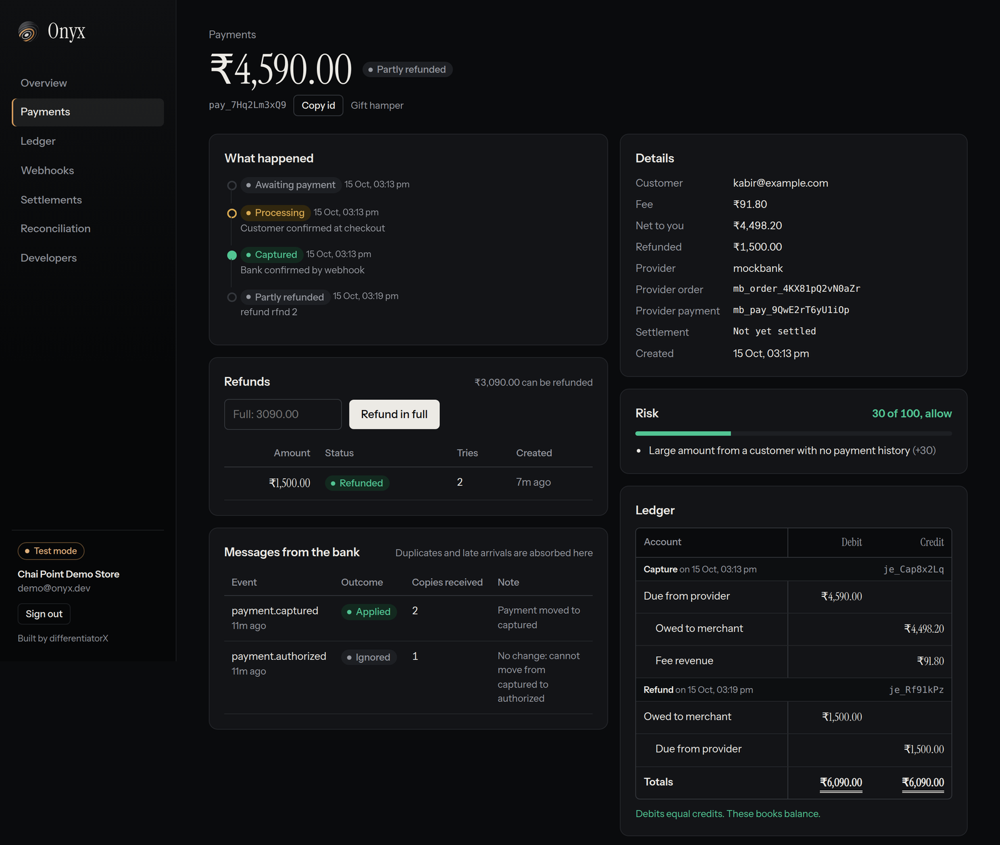
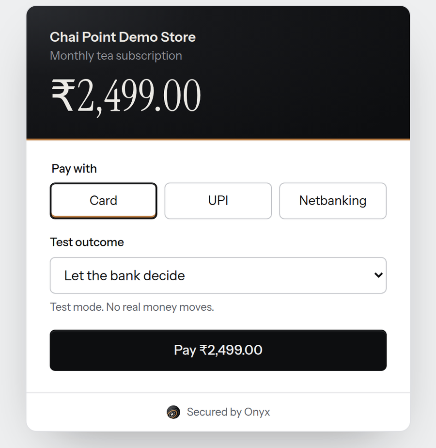
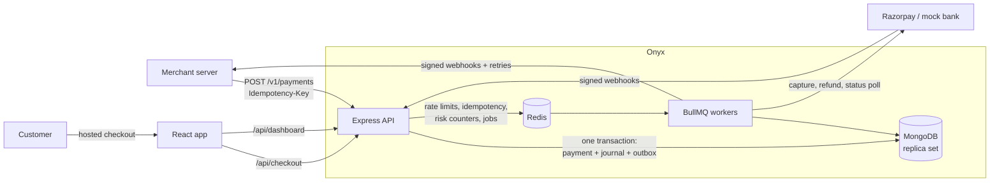
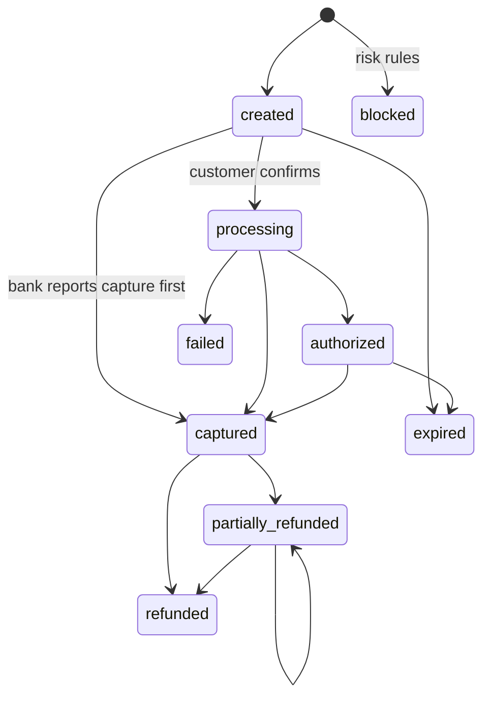

<div align="center">

<a href="https://differentiatorx.github.io/onyx/"></a>

<br><br>

<p>
  <a href="https://github.com/differentiatorX/onyx/actions/workflows/ci.yml"></a>
  
  
  
</p>

<p>
  
  
  
  
  
  
  
  
</p>

<p>
  <a href="https://differentiatorx.github.io/onyx/"><strong>Website</strong></a> &nbsp;·&nbsp;
  <a href="#quick-start">Quick start</a> &nbsp;·&nbsp;
  <a href="#guarantees">Guarantees</a> &nbsp;·&nbsp;
  <a href="#architecture">Architecture</a> &nbsp;·&nbsp;
  <a href="#api-reference">API</a> &nbsp;·&nbsp;
  <a href="docs/INTERVIEW.md">Design deep-dive</a>
</p>

<br>


</div>

## Overview

Most payment projects stop at "the checkout works". Onyx starts there.

Onyx is a banded stone: layer upon layer, laid down permanently. That is the idea behind the system. Every rupee is written into an append-only ledger in balanced layers, and nothing that has been recorded can drift, duplicate or disappear.

Merchants create payments through a REST API, customers pay on a hosted checkout, and every rupee is booked in a **double-entry ledger** that proves itself balanced. Merchants are notified through **signed webhooks** that survive crashes and outages. Balances are **settled** to merchants and **reconciled** against the bank's own records.

It ships with a deliberately unreliable **mock bank** that declines payments, goes silent, and sends duplicate and out-of-order webhooks, so every failure mode can be demonstrated live. Switch one environment variable to run against **Razorpay test mode** instead.

<p align="center">
  
  <br>
  <sub>Every rupee is booked twice. A capture and a refund, closing at 6,090.00 on both sides.</sub>
</p>

<table>
<tr>
<td width="33%" valign="top">

### Never double-charge
Idempotency keys claimed atomically before any work runs. Retries replay the original response.

</td>
<td width="33%" valign="top">

### Books that balance
Every movement is a balanced journal entry. Balances are recomputed from the journal to prove there is no drift.

</td>
<td width="33%" valign="top">

### Nothing gets lost
State change, ledger entry and webhook event commit in one MongoDB transaction, then a worker delivers with retries.

</td>
</tr>
</table>


<p align="center"></p>

## Screenshots

<p align="center"></p>

<table>
<tr>
<td width="62%" valign="top"></td>
<td width="38%" valign="top"></td>
</tr>
<tr>
<td valign="top"><sub>Every payment shows what happened, what the bank said (duplicates and stale events included), its risk score, and its ledger entries as a T-account.</sub></td>
<td valign="top"><sub>Hosted checkout. In test mode you choose how the bank behaves.</sub></td>
</tr>
</table>

## Brand

| Asset | File |
|:--|:--|
| Logo, light backgrounds | [`docs/brand/onyx-logo-light.svg`](docs/brand/onyx-logo-light.svg) |
| Logo, dark backgrounds | [`docs/brand/onyx-logo-dark.svg`](docs/brand/onyx-logo-dark.svg) |
| Mark | [`docs/brand/onyx-mark.svg`](docs/brand/onyx-mark.svg) |

The mark is a polished cross-section of banded onyx with a single sardonyx band. Palette: Onyx `#0D0E10`, Porcelain `#EEEFF0`, Sardonyx `#B97A3E`, Bone `#ECEAE5`. Type: Instrument Serif for money and display, Instrument Sans for everything else.

## Table of contents

- [Screenshots](#screenshots)
- [Guarantees](#guarantees)
- [Architecture](#architecture)
- [Quick start](#quick-start)
- [Demo walkthrough](#demo-walkthrough)
- [API reference](#api-reference)
- [Webhooks](#webhooks)
- [Testing](#testing)
- [Project structure](#project-structure)
- [Design trade-offs](#design-trade-offs)
- [Roadmap](#roadmap)
- [Author](#author)


<p align="center"></p>

## Guarantees

### Watch it hold

Each diagram loops a real failure and the exact way Onyx absorbs it. The [website](https://differentiatorx.github.io/onyx/) has all eight, interactive.

<table>
<tr>
<td width="50%"></td>
<td width="50%"></td>
</tr>
<tr>
<td width="50%"></td>
<td width="50%"></td>
</tr>
</table>

### Every failure, mapped to code

| Failure in production | What Onyx does | Implementation |
|:--|:--|:--|
| Client times out and retries a payment | Key is claimed with a unique index before the handler runs; the stored response is replayed; a different body with the same key is rejected | `middleware/idempotency.js` |
| Two refunds race past the captured amount | Amount is reserved with one atomic conditional update inside a transaction | `services/refundService.js` |
| Payment, ledger and webhooks drift apart | All three commit in a single MongoDB transaction | `services/paymentService.js` |
| Bank sends the same webhook three times | Unique `(provider, eventId)` index; duplicates are counted and dropped | `services/providerEventService.js` |
| "Authorized" arrives after "Captured" | State machine rejects backward transitions and records why | `domain/paymentStateMachine.js` |
| Two workers update one payment | Optimistic concurrency on a `version` field | `paymentService.transition` |
| Bank never sends the webhook | Poller asks the bank directly about stuck payments | `paymentService.pollStuck` |
| Merchant's server is down | Exponential backoff over 8 attempts, then a dead-letter state with one-click replay | `services/webhookService.js` |
| Crash between commit and enqueue | Transactional outbox, idempotent fan-out | `models/OutboxEvent.js` |
| A retry books money twice | Unique idempotency key on every journal entry | `services/ledgerService.js` |
| Are the books actually right? | Balances recomputed from the journal; debits must equal credits | `ledgerService.verifyIntegrity` |
| Our records disagree with the bank | Scheduled reconciliation by amount, status and missing records | `services/reconciliationService.js` |
| One API key floods the system | Token bucket rate limiter as an atomic Redis Lua script | `middleware/rateLimit.js` |
| Card testing and abuse | Rule-based risk scoring with Redis velocity counters | `domain/fraud.js` |
| Floating-point money bugs | Integer paise end to end | `lib/money.js` |


<p align="center"></p>

## Architecture



<details>
<summary><strong>Payment lifecycle</strong></summary>



</details>

<details>
<summary><strong>Ledger postings</strong></summary>

Four accounts per merchant. Every entry balances.

| Event | Debit | Credit |
|:--|:--|:--|
| Capture ₹1,000 with ₹20 fee | Due from provider 1,000 | Owed to merchant 980, Fee revenue 20 |
| Refund ₹300 | Owed to merchant 300 | Due from provider 300 |
| Provider settles | Platform bank | Due from provider |
| Payout to merchant | Owed to merchant | Platform bank |

After a full cycle the platform bank holds exactly the fees, and assets equal liabilities plus revenue. A unit test proves it.

</details>

<details>
<summary><strong>Workers and schedules</strong></summary>

| Queue | Jobs | Schedule |
|:--|:--|:--|
| `payments` | mock bank simulation, provider events, capture, expiry, stuck-payment poll, housekeeping | expiry 60s, poll 30s |
| `refunds` | provider refund calls, 6 attempts with backoff | on demand |
| `webhooks` | merchant delivery, 8 attempts with backoff, dead letter | on demand |
| `maintenance` | outbox relay, settlement, reconciliation | 1s, 5m, 1h |

</details>


<p align="center"></p>

## Quick start

### Docker

```bash
git clone https://github.com/differentiatorX/onyx.git
cd onyx
docker compose up --build
```

| Service | URL |
|:--|:--|
| Dashboard and checkout | http://localhost:5173 |
| API | http://localhost:4000 |

Fill it with realistic traffic, then sign in as `demo@onyx.dev` / `onyx-demo-123`:

```bash
cd server && npm install && npm run seed
```

### Local development

Requires Node 20+, Redis 7 and a MongoDB **replica set**. Transactions need one; the MongoDB Atlas free tier works.

```bash
cd server && cp .env.example .env && npm install
npm run dev            # API on :4000
npm run dev:worker     # workers, second terminal

cd ../client && npm install && npm run dev    # dashboard on :5173
```

### Deploy a live demo

Everything runs on free tiers: MongoDB Atlas, Render (API, workers and Redis via `render.yaml`) and Vercel (dashboard). Step by step in [`docs/DEPLOY.md`](docs/DEPLOY.md).

### Razorpay test mode

Set `PAYMENT_PROVIDER=razorpay` with your test `RAZORPAY_KEY_ID`, `RAZORPAY_KEY_SECRET` and `RAZORPAY_WEBHOOK_SECRET`. Point a Razorpay webhook at `https://<tunnel>/webhooks/razorpay` with the `payment.authorized`, `payment.captured` and `payment.failed` events. Checkout opens Razorpay's modal, Onyx verifies the signature, captures through the API, and books the payment from the webhook or the poller, whichever lands first.

## Demo walkthrough

| Try this | What you will see |
|:--|:--|
| Send one `POST /v1/payments` twice with the same `Idempotency-Key` | One payment; the second response carries `Idempotent-Replayed: true`. Change the body and get 422 |
| Pay with "Let the bank decide" | Random declines, duplicate webhooks (20%) and reordered webhooks (15%), all absorbed and explained on the payment page |
| Pay with "Bank never calls back" | About 90 seconds later the poller recovers the payment and the timeline says how |
| Open Webhooks | The built-in test endpoint fails 30% of requests on purpose, so retries, backoff and dead letters are visible, with replay |
| Refund part of a payment twice, fast | The total never exceeds the captured amount; failed bank refund calls retry |
| Open any payment's ledger | A T-account of every entry, closed with a double rule and a balance check |
| Pay from a `mailinator.com` address, or 6 times from one email in 10 minutes | Risk score, reasons and a review or block decision |
| Settle now, then run reconciliation | Both payout legs in the ledger and a clean match report |


<p align="center"></p>

## API reference

<p align="center"></p>

Amounts are integers in paise. Authenticate with `Authorization: Bearer sk_test_...`.

| Method | Endpoint | Notes |
|:--|:--|:--|
| `POST` | `/v1/payments` | Idempotent. Returns `checkout_url` |
| `GET` | `/v1/payments` | Cursor pagination, `status` and `q` filters |
| `GET` | `/v1/payments/:id` | |
| `POST` | `/v1/payments/:id/refunds` | Idempotent. Omit `amount` to refund in full |
| `GET` | `/v1/refunds/:id` | |
| `GET` | `/v1/balance` | Read from the ledger |
| `POST` `GET` `DELETE` | `/v1/webhook_endpoints` | Signing secret shown once on creation |

<details>
<summary><strong>Example: create and refund</strong></summary>

```bash
curl http://localhost:4000/v1/payments \
  -H "Authorization: Bearer sk_test_..." \
  -H "Idempotency-Key: order-1042" \
  -H "Content-Type: application/json" \
  -d '{"amount": 49900, "description": "Order #1042", "customer": {"email": "riya@example.com"}}'

curl http://localhost:4000/v1/payments/pay_XXXX/refunds \
  -H "Authorization: Bearer sk_test_..." \
  -H "Idempotency-Key: order-1042-refund-1" \
  -H "Content-Type: application/json" \
  -d '{"amount": 10000, "reason": "Damaged item"}'
```

Or with the bundled SDK, which retries safely on its own:

```js
const Onyx = require('./sdk');
const onyx = new Onyx(process.env.ONYX_SECRET_KEY);
const payment = await onyx.payments.create(
  { amount: 49900, customer: { email: 'riya@example.com' } },
  { idempotencyKey: 'order-1042' },
);
```

</details>

<details>
<summary><strong>Errors</strong></summary>

```json
{ "error": { "code": "idempotency_key_reused", "message": "This Idempotency-Key was already used with a different request" } }
```

| Status | Meaning |
|:--|:--|
| 400 | Validation failed; `details` lists each field |
| 401 | Missing or rolled API key |
| 409 | Same key still in progress, or a concurrent refund; retry |
| 422 | Business rule, for example refund above the refundable amount |
| 429 | Rate limited; honour `Retry-After` |

</details>

## Webhooks

Events: `payment.captured`, `payment.failed`, `payment.expired`, `payment.blocked`, `refund.succeeded`, `refund.failed`, `settlement.paid`.

Every request is signed:

```
Onyx-Signature: t=1760512345,v1=<hex hmac_sha256(secret, "t.rawBody")>
```

Verify against the raw body and reject timestamps older than five minutes to block replays. `Onyx.verifyWebhook()` in `sdk/` does both.


<p align="center"></p>

## Testing

```bash
cd server && npm test
```

30 unit tests cover the state machine and out-of-order events, ledger balancing across a full capture, refund, settle and payout cycle, integer fee rounding, risk rules, webhook signatures and replay windows, and idempotency fingerprints.

**Load test** with [k6](https://k6.io). Fires five concurrent requests per idempotency key and fails if any key ever creates two payments:

```bash
k6 run -e API_KEY=sk_test_... server/loadtest/retry-storm.js
```

## Project structure

```
onyx/
├── server/
│   └── src/
│       ├── domain/        pure logic: state machine, ledger, risk, idempotency rules
│       ├── services/      payments, refunds, ledger, webhooks, settlement, reconciliation
│       ├── providers/     Razorpay and mock bank behind one adapter interface
│       ├── middleware/    auth, idempotency, rate limiting, validation, errors
│       ├── routes/        merchant API, dashboard, checkout, provider webhooks
│       ├── models/        Mongoose schemas and indexes
│       └── worker.js      BullMQ workers and schedules
├── client/                React dashboard and hosted checkout
├── sdk/                   zero-dependency Node.js client
├── docs/INTERVIEW.md      design deep-dive in question and answer form
└── docker-compose.yml     MongoDB replica set, Redis, API, worker, dashboard
```

## Design trade-offs

- **Settlement is a balance sweep**, not per-payment T+2. It keeps the ledger consistent with refunds that land after settlement; production gateways track settlement per payment.
- **Razorpay refunds are not idempotent on Razorpay's side.** Onyx calls refund from one job per refund id and flags refunds stuck after a crash for a human instead of resending money.
- **Ledgers are per merchant.** A platform-wide general ledger would aggregate them.
- **INR only.** Multi-currency needs FX accounts in the ledger.

## Roadmap

- [ ] Per-payment T+2 settlement with settlement files
- [ ] MongoDB change streams in place of the polling outbox relay
- [ ] Prometheus metrics and alerts on dead letters and ledger drift
- [ ] UPI AutoPay subscriptions
- [ ] Encrypted webhook secrets at rest

## Acknowledgements

Patterns were studied from two open-source projects and implemented from scratch here: the provider adapter, state machine and webhook safety from [anirbanshit29/payment-reliability-engine](https://github.com/anirbanshit29/payment-reliability-engine), and the double-entry ledger, settlement pipeline and fraud rules from [MOHITU778/payflux](https://github.com/MOHITU778/payflux).

## Website

The landing page lives in [`docs/index.html`](docs/index.html) and is served by GitHub Pages at **https://differentiatorx.github.io/onyx/**. To publish it: repository Settings, Pages, deploy from branch `main`, folder `/docs`.


<p align="center"></p>

## Author

<table>
<tr>
<td>

**differentiatorX**

[](https://github.com/differentiatorX)
[](mailto:madhur.m2006@gmail.com)

</td>
</tr>
</table>

Questions, bugs or ideas: [open an issue](https://github.com/differentiatorX/onyx/issues) or write to madhur.m2006@gmail.com.

## License

Released under the [MIT License](LICENSE). Copyright © 2026 differentiatorX.

<div align="center">
<br>
<sub>Onyx, payments set in stone. Built by <a href="https://github.com/differentiatorX">differentiatorX</a>.</sub>
</div>
